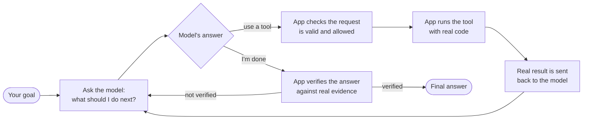
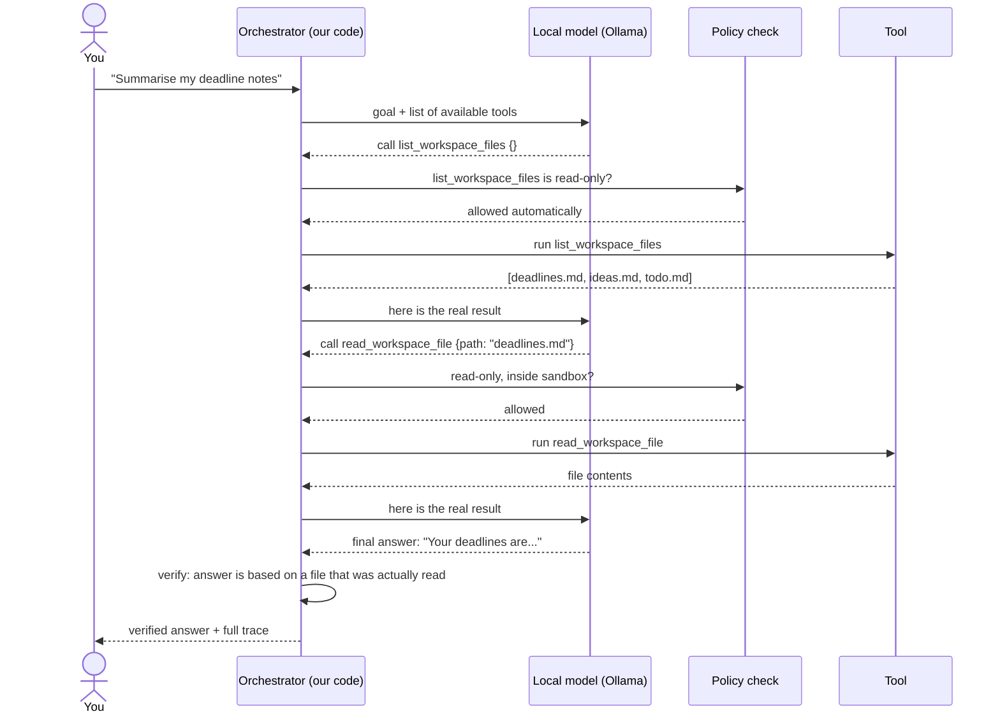
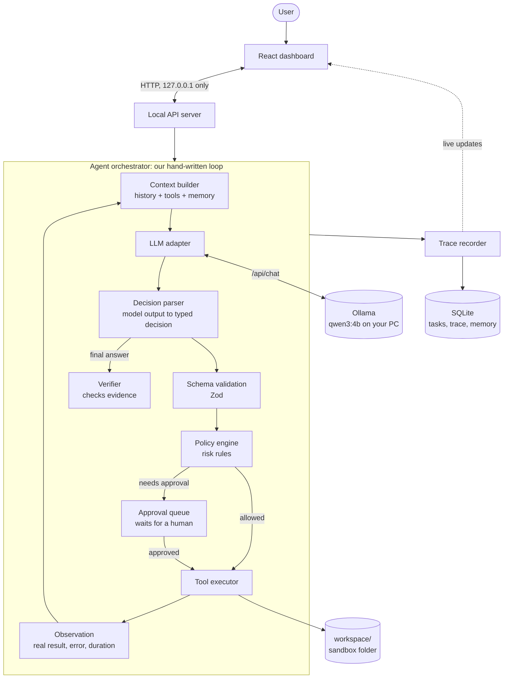
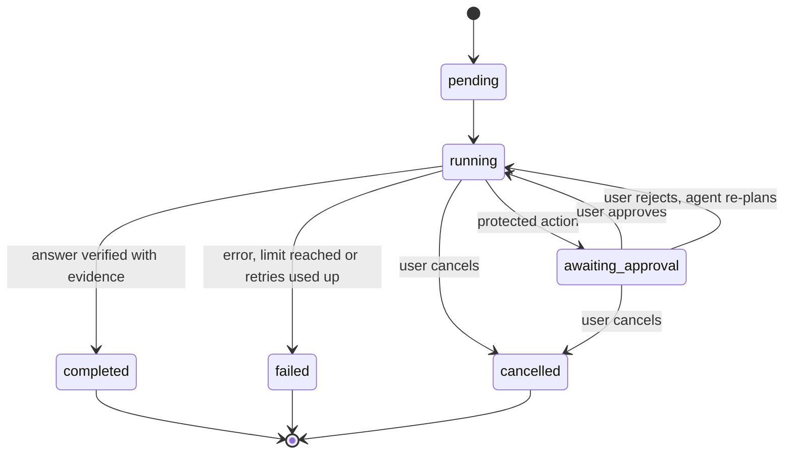
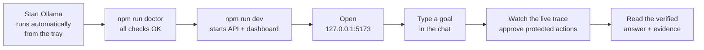

# Local AI Agent Lab: learn how AI agents work by building one

A **local-first AI agent** that runs entirely on your Windows PC. It uses a free, local language model through [Ollama](https://ollama.com). It needs no API keys and no cloud services, and your files never leave your machine.

The agent loop, tool system, permissions, memory and execution trace are **written by hand in TypeScript**. There is no LangChain or other agent framework, so you can read and understand every step the agent takes.

> **Current status: Phase 1 of 9 complete.** The environment check, architecture, interfaces and tests are done.
> The agent loop, tools and dashboard are **not built yet**. This README describes both what works today and what is planned, and each section is labelled.
> See the [phase checklist](PHASES.md) for exact progress.

---

## Table of contents

1. [What problem does this solve?](#1-what-problem-does-this-solve)
2. [What will the agent do?](#2-what-will-the-agent-do)
3. [How an AI agent works (simple version)](#3-how-an-ai-agent-works-simple-version)
4. [Architecture](#4-architecture)
5. [Tech stack](#5-tech-stack)
6. [Setup guide (step by step)](#6-setup-guide-step-by-step)
7. [Running the project](#7-running-the-project)
8. [Configuration](#8-configuration)
9. [Project structure](#9-project-structure)
10. [Safety design](#10-safety-design)
11. [Roadmap](#11-roadmap)
12. [Troubleshooting](#12-troubleshooting)
13. [Further reading](#13-further-reading)

---

## 1. What problem does this solve?

AI "agents" are everywhere, but they are usually hidden behind cloud APIs and large frameworks. That makes several basic questions hard to answer:

- **How does an agent decide** which tool to use?
- **What actually happens** between "the model said X" and "a file was created"?
- **How do you stop an agent** from doing something dangerous, looping forever, or claiming success when it failed?
- **Can I run one privately** without paying for an API or sending my data to the cloud?

This project answers those questions with **working, readable, tested code**:

| Problem | How this lab addresses it |
|---|---|
| Agents feel like a black box | Every step is recorded in an execution trace, with a beginner-friendly explanation |
| Frameworks hide the core loop | The loop is written by hand in small, readable modules |
| Cloud APIs cost money and see your data | It runs 100% locally with Ollama: no keys, no internet needed after setup |
| Agents can take unsafe actions | A sandboxed workspace, risk levels, human approval and deny-by-default rules |
| Agents can "hallucinate" success | A verifier checks real evidence before a task is marked complete |
| LLM output is unpredictable to test | A mock LLM and replayable fixtures give deterministic tests |

**Who is it for?** Developers who want to understand agent internals well enough to build, debug and secure their own agents.

---

## 2. What will the agent do?

*(Planned. Tools arrive in Phase 3 and the agent loop in Phase 4.)*

You give the agent a goal in plain English. It decides which **registered tools** to use, runs them safely, looks at the real results and keeps going until the goal is achieved and verified.

**Example goals:**

- "What notes do I have about the project, and summarise the one about deadlines."
- "Calculate 15% of 2,340 and save the result as a note."
- "What time is it, and what was the status of my last task?"

**Initial tools:**

| Tool | What it does | Risk level |
|---|---|---|
| `calculator` | Safe maths (no `eval`) | Read-only |
| `get_current_time` | Local system time | Read-only |
| `list_workspace_files` | Lists files in the sandbox folder | Read-only |
| `read_workspace_file` | Reads a file in the sandbox | Read-only |
| `search_workspace` | Searches text across sandbox files | Read-only |
| `get_task_status` | Looks up a previous task | Read-only |
| `create_note` | Creates a new note (never overwrites) | Reversible write, needs approval |
| `append_task_log` | Saves a note about a task | Reversible write, needs approval |

There is deliberately **no** shell access, arbitrary code execution, browser control or credential access.

---

## 3. How an AI agent works (simple version)

A language model on its own is **just a text-in, text-out function**. It can't read files or check the clock.

An **agent** is ordinary software that calls the model **in a loop** and offers it a menu of tools:



**The key idea:** the **model suggests**, but **your code decides**.

| The model decides (unpredictable) | The application enforces (predictable) |
|---|---|
| Which tool to try next | Whether that tool exists |
| What arguments to use | Whether the arguments match the schema |
| When it thinks it's finished | Whether the action's risk level is allowed |
| How to word the answer | Whether a human must approve first |
| | How many steps, retries and seconds are allowed |
| | Whether "finished" is backed by evidence |

A worked example of one run *(target behaviour after Phase 4)*:



---

## 4. Architecture



Every box is a **TypeScript interface**, so you can swap the model, add tools or replace the UI without rewriting the rest. Details are in [ARCHITECTURE.md](ARCHITECTURE.md).

**Task lifecycle:** a task is only marked `completed` after verification.



---

## 5. Tech stack

| Layer | Technology | Why it was chosen |
|---|---|---|
| Local LLM | [Ollama](https://ollama.com) + `qwen3:4b` | Free, private, supports tool calling, fits a 16 GB laptop |
| Language | TypeScript 7 | Typed contracts between every component |
| Runtime | Node.js 24 | Built-in `node:sqlite`, modern `fetch` and `AbortSignal` |
| API server | Fastify *(Phase 2)* | Small, fast, schema-friendly |
| Database | SQLite via built-in `node:sqlite` | No native add-on to compile on Windows |
| Validation | Zod 4 | Validates tool arguments and generates the JSON Schema sent to the model |
| Frontend | React 19 + Vite 8 | Developer dashboard *(Phase 7)* |
| Tests | Vitest | Fast, TypeScript-native |
| Package manager | npm workspaces | One install for server, web and shared types |

**What is deliberately not used:** LangChain, LlamaIndex or any agent framework (so you build the loop yourself), cloud LLM APIs and hosted databases.

---

## 6. Setup guide (step by step)

### Requirements

| | Minimum | Tested on |
|---|---|---|
| OS | Windows 10/11 | Windows 11 |
| RAM | 8 GB (16 GB recommended) | 15.7 GB |
| Disk | about 5 GB free | |
| Node.js | 22.13 or newer | 24.21 |
| GPU | Optional (it runs on the CPU) | MX570 2 GB, mostly CPU |

### Step 1: Install Node.js

Download the LTS version from https://nodejs.org/ and install it. Then check:

```powershell
node --version   # should print v22.13.0 or higher
npm --version
```

### Step 2: Install Ollama

1. Download **OllamaSetup.exe** from https://ollama.com/download/windows and run it.
2. Ollama starts in the background, with an icon in the system tray.
3. **Restart VS Code or your terminal** so the `ollama` command is found.
4. Check it:
   ```powershell
   ollama --version
   ```

### Step 3: Download the model

```powershell
ollama pull qwen3:4b
```

This downloads about 2.5 GB. Choose a different model to suit your hardware:

| Model | Size | When to use |
|---|---|---|
| `qwen3:1.7b` | 1.4 GB | Low RAM or slow PC: fastest, weakest tool choices |
| **`qwen3:4b`** | **2.5 GB** | **Default: a good balance** |
| `qwen3:8b` | 5.2 GB | 16 GB+ RAM with about 7 GB free: better reasoning |

### Step 4: Get the code

```powershell
git clone https://github.com/Afaquejaya/learn-basic-ai-agent.git
cd learn-basic-ai-agent
npm install
```

> npm 11 may print `install-scripts ... esbuild` warnings. These are harmless; the tools still work.

### Step 5: Check your environment

```powershell
npm run doctor
```

Expected output:

```
[ OK ] Node.js: found v24.21.0, need >= 22.13.0
[ OK ] SQLite (node:sqlite): SQLite 3.53.4 built into Node
[ OK ] System memory: 15.7 GB total, 6.2 GB free
[ OK ] Ollama server: reachable at http://127.0.0.1:11434, version 0.40.5
[ OK ] Model qwen3:4b: installed locally
[ OK ] Tool calling: capabilities: completion, tools, thinking
All required checks passed.
```

For any `[FAIL]` line, the doctor prints the exact fix underneath it.

### Step 6: Run the tests

```powershell
npm test
```

Expected: `Test Files 2 passed`, `Tests 15 passed`. These tests use mocks, so they don't need Ollama running.

---

## 7. Running the project

### What you can run today (Phase 1)

| Command | What it does |
|---|---|
| `npm run doctor` | Checks Node, SQLite, RAM, Ollama, the model and tool-calling support |
| `npm test` | Runs the unit tests |
| `npm run typecheck` | Type-checks all packages |
| `npm run dev:web` | Starts a **placeholder** page at http://127.0.0.1:5173 |

### Full run flow (once all phases are done)



The `npm run dev` command and the dashboard are added in Phases 2 and 7. They don't exist yet.

---

## 8. Configuration

All settings have safe defaults. Override them with environment variables (PowerShell example: `$env:LAB_MODEL="qwen3:8b"`).

| Variable | Default | Notes |
|---|---|---|
| `LAB_HOST` | `127.0.0.1` | **Must** be loopback; anything else is rejected |
| `LAB_PORT` | `8787` | API port |
| `OLLAMA_URL` | `http://127.0.0.1:11434` | Must be a local address |
| `LAB_MODEL` | `qwen3:4b` | Cloud models (`*-cloud`) are rejected |
| `LAB_LLM_TIMEOUT_MS` | `120000` | Time limit per model call |
| `LAB_MAX_ITERATIONS` | `8` | Maximum loop steps per task |
| `LAB_TASK_TIMEOUT_MS` | `300000` | Time limit for a whole task |
| `LAB_MAX_RETRIES` | `2` | Retries per failed step |
| `LAB_WORKSPACE_DIR` | `./workspace` | The only folder file tools may touch |
| `LAB_DB_FILE` | `./data/agent-lab.sqlite` | SQLite database file |

---

## 9. Project structure

```
learn-basic-ai-agent/
├── packages/shared/        Shared types: Task, PlanStep, TraceEvent, ...
├── apps/server/
│   ├── src/
│   │   ├── config.ts       Validated settings (safety rules live here)
│   │   ├── env/            Environment doctor
│   │   ├── llm/            Model adapter interface          → Phase 2
│   │   ├── tools/          Tool registry + executor         → Phase 3
│   │   ├── agent/          The agent loop (orchestrator)    → Phase 4
│   │   ├── planning/       Decision parser + verifier       → Phase 4–5
│   │   ├── persistence/    SQLite storage                   → Phase 5
│   │   ├── policy/         Permissions + approvals          → Phase 6
│   │   ├── trace/          Execution trace                  → Phase 4–7
│   │   └── memory/         Conversation + long-term memory  → Phase 8
│   ├── scripts/doctor.ts   `npm run doctor`
│   └── test/               Automated tests
├── apps/web/               React dashboard                  → Phase 7
├── workspace/              The agent's sandbox (untrusted data)
├── data/                   SQLite database (not committed)
├── ARCHITECTURE.md         Design decisions in depth
├── LEARNING_GUIDE.md       Concepts + exercises, grows each phase
└── PHASES.md               Progress checklist
```

---

## 10. Safety design

The agent is built on the assumption that **the model can be wrong, confused or manipulated**.

| Risk | Protection | Status |
|---|---|---|
| Server exposed to the network | Config refuses any non-loopback host | ✅ Done |
| Accidentally using a cloud model | Config rejects `*-cloud` models and non-local Ollama URLs | ✅ Done |
| Model runs arbitrary code | It can only pick from registered tools; no shell or `eval` | Phase 3 |
| Bad or malicious tool arguments | Strict Zod schema validation | Phase 3 |
| Escaping the sandbox (`..\..\Windows`) | Path guard keeps all file access inside `workspace/` | Phase 3 |
| Overwriting files | `create_note` refuses to overwrite | Phase 3 |
| Infinite loops | Limits on iterations, time and retries, plus cancellation | Phase 4 |
| Agent approves its own action | Only the human-facing API route can approve | Phase 6 |
| Prompt injection in files ("ignore your rules...") | File content is treated as data, never as instructions | Phase 6 |
| False "task complete" claims | A verifier requires real evidence | Phase 4–5 |

---

## 11. Roadmap

| Phase | What gets built | Status |
|---|---|---|
| 1 | Environment check, architecture, interfaces, docs | ✅ Done |
| 2 | Ollama adapter, health check, basic chat API | Next |
| 3 | Tool registry and the 8 initial tools | |
| 4 | The agent loop: decide, validate, execute, observe, repeat | |
| 5 | Structured plans, task states, SQLite persistence, crash recovery | |
| 6 | Permissions, approval queue, security checks | |
| 7 | Dashboard with live execution trace | |
| 8 | Memory, deterministic replay, evaluation experiments | |
| 9 | End-to-end tests and final documentation | |

---

## 12. Troubleshooting

| Problem | Fix |
|---|---|
| `ollama` is not recognised | Restart VS Code or the terminal after installing Ollama. It lives in `%LOCALAPPDATA%\Programs\Ollama`. |
| Doctor: `Ollama server ... not reachable` | Start Ollama from the Start menu, or run `ollama serve` |
| Doctor: `Model qwen3:4b: not installed` | `ollama pull qwen3:4b` |
| Doctor: `[WARN] System memory` | Close browser tabs or other heavy apps; the model needs about 3–4 GB free |
| `server.host must be a loopback address` | You set `LAB_HOST` to a network address. Run `Remove-Item Env:LAB_HOST` |
| Responses are very slow | Normal on CPU. Try `$env:LAB_MODEL="qwen3:1.7b"` |

---

## 13. Further reading

- [ARCHITECTURE.md](ARCHITECTURE.md): component interfaces and design decisions
- [LEARNING_GUIDE.md](LEARNING_GUIDE.md): concepts explained, with hands-on exercises
- [PHASES.md](PHASES.md): detailed progress checklist
- [Ollama tool-calling docs](https://docs.ollama.com/capabilities/tool-calling)
